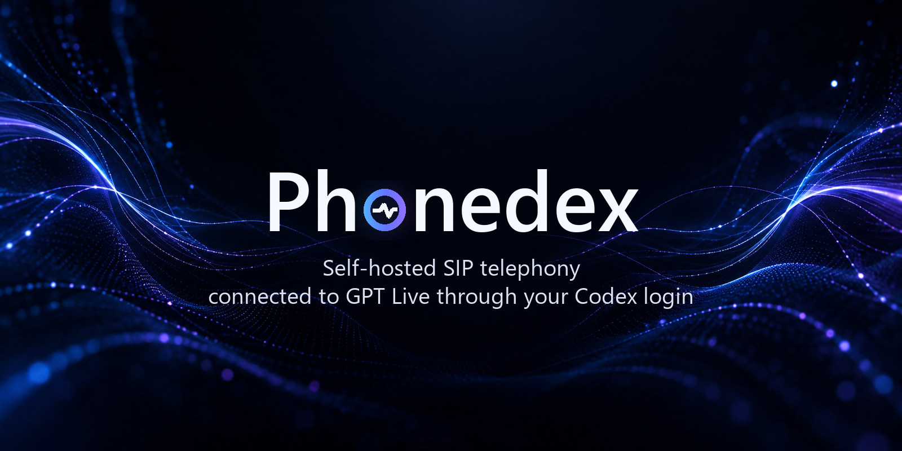
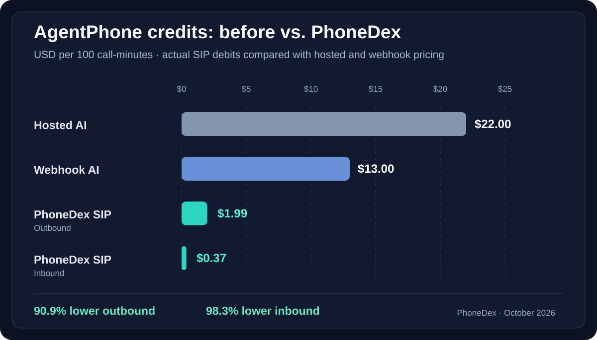
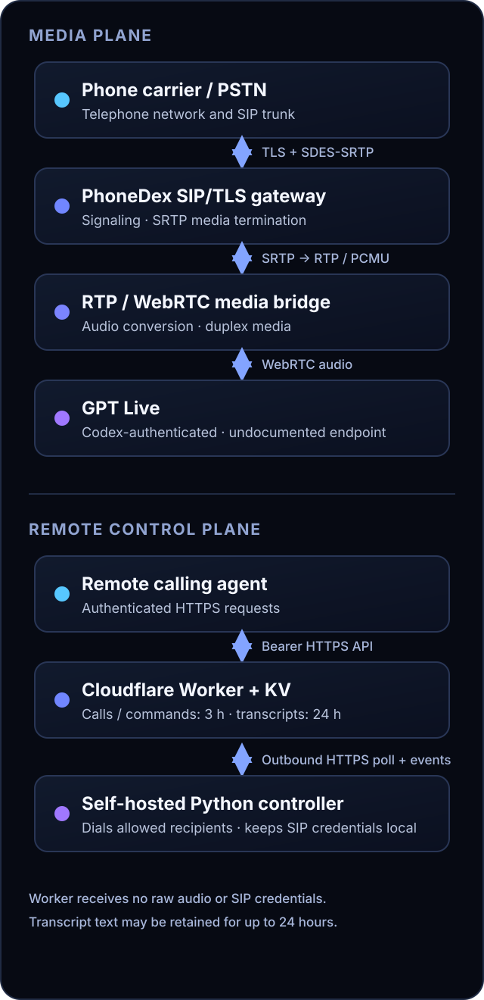

# PhoneDex

<p align="center">
  
</p>

<p align="center">
  <a href="LICENSE"></a>
  
</p>

<p align="center"><strong>Self-hosted SIP telephony connected to GPT Live through Codex authentication.</strong></p>

> [!WARNING]
> PhoneDex is an experimental source preview, not a production-ready telephone service or a hardened SIP border controller. It uses an undocumented GPT Live subscription endpoint whose availability and authorized use are not guaranteed.

[Overview](#overview) · [Features](#features) · [Architecture](#architecture) · [Quickstart](#quickstart) · [Troubleshooting](#troubleshooting) · [Limitations](#limitations-and-roadmap) · [Documentation](#documentation)

## Overview

PhoneDex connects a SIP telephone call to a GPT Live voice session through a self-hosted Python media bridge. An optional Cloudflare Worker and KV namespace provide an authenticated control plane for remote agents to queue outbound calls, inspect status and transcripts, privately steer a live session, and request hangup.

Unlike a typical API-key voice agent, PhoneDex reads a local Codex CLI login and negotiates with a subscription-backed GPT Live endpoint. That endpoint is undocumented and is not the public Realtime API. Access may change or be restricted; you are responsible for confirming that your use is permitted. SIP carrier charges still apply, and PhoneDex has no API-key or paid-inference fallback. PhoneDex is an independent project with no OpenAI, Codex, or AgentPhone endorsement.

### Measured AgentPhone call-credit savings

From actual October 2026 AgentPhone billing transactions, PhoneDex SIP reduced
**outbound AgentPhone charges by ~90.9%** and **inbound charges by ~98.3%**
compared with AgentPhone's published $0.22/min hosted-voice rate.
That works out to about **$1.99 outbound** or **$0.37 inbound** per 100
call-minutes, versus **$22.00** for hosted voice.

See the [transaction-backed cost comparison](docs/AGENTPHONE_CREDIT_SAVINGS.md)
for the sample ledger, rate calculations, and a directly comparable 23-second
hosted-versus-SIP call.



### Windows quickstart: guided PhoneDex CLI

The optional [PhoneDex CLI](https://github.com/dexifried/Phonedex-CLI) provides
a **Windows-first, resumable setup experience**. It guides cloning, isolated
Python dependencies, Codex sign-in, AgentPhone/SIP configuration, Windows UDP
media forwarding, local checks and a separately approved test call:

```powershell
pipx install phonedex-cli
phonedex-cli wizard
```

[Detailed Windows setup guide](https://github.com/dexifried/Phonedex-CLI/blob/main/docs/WINDOWS_SETUP.md).
Install Python 3.11+ and pipx first. You still need your own SIP provider,
credentials and router access. The wizard cannot guarantee a working call.

## First five minutes: local quickstart

**Start here** if you want to try PhoneDex. This prepares an isolated Python
environment; it does **not** register a phone number, place calls, configure your
router or create any Cloudflare resources.

```sh
git clone https://github.com/dexifried/Phonedex.git
cd Phonedex
python scripts/bootstrap.py
```

The bootstrap asks permission before creating `.venv` and installing its
dependencies. It never installs globally, overwrites `.env`, or touches SIP
settings. Need to inspect first? Run `python scripts/bootstrap.py --check`
(read-only), even if optional packages aren't installed.

Next, sign into the Codex CLI using `codex login` and run the project-local
Python interpreter that bootstrap prints:

- **Windows:** `.venv\Scripts\python.exe phonedex.py setup --check`
- **macOS/Linux:** `.venv/bin/python phonedex.py setup --check`

Then run `phonedex.py setup` using that same interpreter to enter your own SIP
provider details privately. This is an **outbound local setup**:
Cloudflare/Node/Wrangler aren't needed. No calls are made until you explicitly
use `dial --place-call` with an allowlisted number.

> You'll still need access to a compatible SIP provider, your provider's
> termination credentials and approved caller ID, and working UDP media
> connectivity for a real call. This is not a provider-free demo or
> one-click phone-number provisioning.

**Have a problem?** The short [first-run checklist](docs/FIRST_RUN.md) separates
local preparation, Codex authentication, SIP configuration and the first
authorized call. Share only the sanitized `setup --check` output when
asking for help—**never** credentials, full `.env`, or auth files.

## Set up with your coding agent

**Have Codex, Claude Code, Cursor, or another coding agent with terminal access?** Copy this entire prompt into the agent. It can inspect your machine, guide your logins and configure PhoneDex for you instead of making you follow every step manually.

```text
Set up PhoneDex on my computer using its official repository:
https://github.com/dexifried/Phonedex

You have permission to inspect my local environment and prepare the project,
but do not assume permission for chargeable calls or external changes.

1. Clone the repository (or locate my existing checkout), read the README,
   SECURITY.md, docs/RELEASE_STATUS.md and any onboarding instructions.
   Check the actual available CLI commands before using them.
2. Ask whether I want (A) local outbound calling, (B) remote agent control
   through my own Cloudflare account, or (C) advanced inbound calling.
   Start with the simplest supported path; Cloudflare is optional for A.
3. Check my OS, Python/Node availability, Codex CLI and SIP-provider
   compatibility. Explain missing prerequisites, and get my approval before
   installing packages or changing system settings. Prefer an isolated Python
   environment rather than installing packages globally.
4. Guide me through Codex login and provider login using their normal local
   authentication flows. Do not ask me to paste passwords, API keys, SIP
   credentials, OAuth tokens or auth.json contents into your chat. Enter
   secrets through private local prompts/configuration; never print, upload,
   commit or share them.
5. If available, use "python phonedex.py setup --check" and the interactive
   "python phonedex.py setup" wizard. Otherwise follow the documented
   .env.example and "python phonedex.py doctor" flow. Do not overwrite any
   existing configuration without my explicit approval.
6. For remote control, ask approval before creating Cloudflare resources,
   deploying Workers, changing DNS, or setting secrets. For inbound calling,
   explain TLS/SRTP, firewall, public IP, carrier routing and port forwarding.
   Never open ports or enable calling without permission.
7. Run the documented offline tests and a dry-run dial only to a number I
   have explicitly approved. NEVER place a real call, enable paid services,
   make purchases, or deploy to production without asking me first.
8. At the end, report what is working, what's not yet verified, any security
   or billing risks, and the exact next action required from me.

Important: PhoneDex is experimental and uses an undocumented GPT Live
subscription endpoint. Verify applicable authorization/terms; do not assume
that an existing ChatGPT/Codex subscription grants production calling rights.
Do not claim success until the relevant checks actually pass.
```

> **Manual setup instead?** Continue to the [Quickstart](#quickstart). The agent prompt is an installation guide, **not** a one-click installer: SIP-provider credentials, account sign-ins, networking and real phone calls may still require your participation.

## Features

### Implemented in this repository

- SIP over TLS with PCMU audio and SDES-SRTP media; the gateway rejects plain RTP offers.
- Duplex WebRTC voice sessions connected to GPT Live using the local Codex OAuth cache.
- Caller barge-in: sustained caller speech clears queued AI audio, sends quiet RTP during interruption, and lets the caller finish. Local echo rejection reduces false triggers.
- **Outbound voicemail screening:** hold GPT Live silent while checking for a live human versus a long answering-machine greeting. For probable voicemail, wait until a narrowband beep has *finished* before allowing the agent to leave a message; abandon without speaking if no beep is confidently found.
- A self-hosted controller that polls the Worker over outbound HTTPS and does not expose a public management listener.
- Optional Worker control routes for dispatch, status, transcripts, private steering, command acknowledgements, and hangup.
- Normal and business prompt modes. Business mode can read a local profile and a read-only calendar snapshot. It does not book appointments or send messages.
- **Optional caller personas:** local AI name, style and accent preferences; separate named agents; disabled by default.
- **Voicemail re-entry heuristic:** a distinct short receptionist reply after a recorded greeting can allow a human call to continue. This is audio-only and not a validated carrier-level voicemail detector.
- **Encrypted personal calling profile:** local AES-GCM vault protected by a passphrase, with explicit per-field sharing for one manual outbound call only. No unattended vault access.
- Default-deny outbound recipient allowlisting, per-day call limits, a one-call concurrency limit, and separate operator and gateway bearer secrets.
- **Privacy-controlled transcripts:** choose `off` (default), `local`, `worker`, or `both`. Local SQLite keeps conversation text on your own machine; Worker/KV transcript export is explicitly opt-in. Remote call control continues to work without transcript upload.
- Transcript normalization, duplicate suppression across event sources, and retries for failed Worker transcript uploads when enabled.
- Optional **AgentPhone Calls dashboard transcript sync** for inbound calls, using the caller number and timestamp to match exactly one completed provider record. Disabled unless explicitly configured.

### Experimental or not verified

- Public inbound SIP listening is opt-in and requires a trusted TLS certificate, explicit carrier source ranges, and a verified SRTP media path.
- The SIP implementation is not a complete transaction stack or certified SBC. Provider, NAT, TLS, and SDP compatibility outside the limited validation recorded in the [release status](docs/RELEASE_STATUS.md) is unknown.
- Transcripts are model-generated text, can be delayed by polling and KV consistency, and are not certified verbatim records.
- Barge-in is an RTP playback cutoff, not a documented GPT Live model-level cancellation; false positives and imperfect response resumption remain possible.
- Voicemail screening is heuristic, and can mistake a long human greeting or unusually short recorded greeting. Machine calls without a recognizable beep are not left a message. Generic voicemail speaking needs an optional local 24-kHz WAV wake primer, which is not bundled.
- A consent-gated lead-storage helper writes to local SQLite, but the live voice delegation path does not call it yet.
- The subscription endpoint and private steering event can change without notice. Steering does not guarantee that the model will follow an instruction.

### Planned

- Cold transfer to a preapproved human destination.
- Warm three-way introduction followed by a direct human-to-human conversation.
- Complete GPT Live and WebRTC shutdown after a successful handoff.
- More reliable SIP lifecycle handling, faster startup, and simpler deployment.

Human transfer is **not implemented**. The [handoff document](docs/CALL_HANDOFF_SPEC.md) is a specification, not an implementation promise.

## Architecture

<p align="center">
  
</p>

The Worker handles call instructions and text metadata. It does not receive raw audio or SIP credentials. **Transcript text is not sent to Workers KV by default**; `PHONEDEX_TRANSCRIPT_MODE=worker` or `both` enables it. Phone numbers, dial prompts, status and command metadata still go to the Worker when remote control is used.

### Self-hosted transcript privacy

PhoneDex makes conversation-text retention an explicit choice:

| `PHONEDEX_TRANSCRIPT_MODE` | Save transcripts locally | Send transcripts to Workers KV |
| --- | --- | --- |
| `off` (default) | No | No |
| `local` | Yes, SQLite | No |
| `worker` | No | Yes |
| `both` | Yes | Yes |

In `local` mode, inbound and outbound GPT Live text is written under `PHONEDEX_DATA_DIR` (default `~/.phonedex/transcripts.sqlite3`) and can be listed or deleted locally. Configurable retention defaults to 7 days; expired records are pruned on writes or manual cleanup. **The local database is plaintext**, so protect your machine and backups.

The optional AgentPhone Calls dashboard export is independently disabled by default. This does not hide call media from the SIP provider or GPT Live: both still process the call. See [Transcript privacy and local storage](docs/TRANSCRIPT_PRIVACY.md) for exact data boundaries, security limitations and deletion commands.

## Quickstart

### Prerequisites

- Python 3.11 or newer.
- Codex CLI logged into a ChatGPT account that can access the required session.
- A SIP provider configured for TLS signaling, PCMU, and SDES-SRTP. Public inbound use also needs a trusted certificate, source-IP allowlisting, and reachable UDP media port.
- Node.js for the Worker tests and Wrangler CLI. Use a currently supported Node.js release for Wrangler.
- A Cloudflare account and Workers KV namespace only if you want remote agent controls. Remote transcript uploads are disabled by default.

PhoneDex has not been verified across arbitrary SIP providers. A dry run and the offline test suites do not make a real call.

### Install and authenticate

From a terminal:

```sh
git clone https://github.com/dexifried/Phonedex.git
cd Phonedex
python scripts/bootstrap.py
codex login
```

**Recommended:** use the guided setup wizard. It runs locally, does not place phone calls or deploy anything, and refuses to overwrite an existing `.env`:

```sh
# Use the .venv Python printed by bootstrap. Windows:
.venv\Scripts\python.exe phonedex.py setup --check
.venv\Scripts\python.exe phonedex.py setup

# On macOS/Linux, replace .venv\Scripts\python.exe
# with .venv/bin/python.
```

For manual setup **instead**, copy the example configuration to a private local file:

```powershell
Copy-Item .env.example .env
```

On macOS or Linux, use `cp .env.example .env`. Edit `.env` with your SIP termination URI, public IP, caller ID, SIP credentials, media port, and—if using remote control—the Worker URL and gateway token. Keep `PHONEDEX_ALLOWED_RECIPIENTS` empty until you are ready to authorize specific E.164 destinations. Set `PHONEDEX_MEDIA_PORT_FORWARDED=1` only after the SRTP UDP port is actually forwarded. Never commit `.env`.

### Optional personal calling profile

Store a chosen AI assistant name and voice style, or create a named agent persona:

```sh
python phonedex.py settings set assistant_name Muse
python phonedex.py settings set enabled on
python phonedex.py settings --agent muse set assistant_name Muse
python phonedex.py settings --agent muse set enabled on
```

To store personal details in the encrypted local vault, use
`python phonedex.py profile fields` and `python phonedex.py profile set full_name`.
The CLI prompts privately for a passphrase and the field value. **Nothing from
that vault is shared automatically.** An operator can explicitly choose fields
for one manual outbound call via `--share-fields`, with confirmation and unlock.

**Provider-verified personal caller IDs and press-1/press-* human handoff are
not implemented** in this public version; they require carrier verification
and tested multi-leg SIP support. See [caller profiles and limitations](docs/CALLING_PROFILE.md).

### Optional: remote agent control

Create a KV namespace and use its returned ID in a private copy of `worker/wrangler.toml.example`:

```sh
cd worker
npx wrangler kv namespace create STORE
```

```powershell
Copy-Item wrangler.toml.example wrangler.toml
```

On macOS or Linux, use `cp wrangler.toml.example wrangler.toml`. Replace the placeholder namespace ID in `wrangler.toml`, then deploy the Worker and add two independent random secrets:

```sh
npx wrangler deploy
npx wrangler secret put AGENT_CONTROL_TOKEN
npx wrangler secret put VOICE_GATEWAY_TOKEN
```

Each secret command prompts for a value and deploys a Worker version. Put the `VOICE_GATEWAY_TOKEN` value in local `.env` as `PHONEDEX_GATEWAY_TOKEN`; keep `AGENT_CONTROL_TOKEN` separate and give it only to the remote calling agent. Set `PHONEDEX_GATEWAY_URL` to the deployed Worker URL ending in `/agent/gateway`. The local `worker/wrangler.toml` is ignored by Git.

### Outbound voicemail: stay silent until the beep

PhoneDex screens **outbound answered calls only** (never the inbound receptionist).
During screening it sends quiet RTP to keep the carrier connection alive, but
**does not start GPT Live speaking**. A short hello followed by silence is
treated as a person and released for a normal conversation. A prolonged
recorded greeting remains silent while the detector listens for a sustained
narrowband beep; it only releases the agent when that beep has **finished**.

The outbound mode defaults to `auto`. You can disable it with
`PHONEDEX_VOICEMAIL_MODE=off` in your private environment or with the
`--voicemail-mode off` flag on `phonedex.py dial` or `sip_outbound.py`.
No chargeable calls are placed by the offline tests.

For GPT Live to **initiate** its first spoken voicemail message reliably,
provide a private **24-kHz mono PCM16** audio primer, as you would for the
existing synthetic-greeting mechanism:

```dotenv
PHONEDEX_VOICEMAIL_MODE=auto
PHONEDEX_MODEL_WAKE_FILE=path/to/your/private/model-wake.wav
``

`phonedex.py` and the outbound controller read these variables from
their configured environment. You can alternatively supply
`--model-wake-file` for a manual `phonedex.py dial` command.
This is a model-input wake clip **not** a recording played to the recipient
and it must not be committed to Git. When voicemail is detected, the live
session starts with instructions to leave a concise message. Without a wake
primer, the undocumented GPT Live session may not initiate speech on its own.

**Limitations:** No answering-machine detector is infallible. The heuristic
may mistake human speech for a voicemail greeting, or miss short/atypical
beeps. If a suspected machine reaches the 25-second detection limit without
a convincing beep, PhoneDex ends the call **without talking**. This does not
guarantee a message was delivered: test with a number and carrier that you
are authorized to call before relying on it for important messages.

### Optional AgentPhone call-history transcripts

You can opt in to push **text-only** GPT Live transcripts from completed **inbound**
calls to your own AgentPhone Calls dashboard. This requires an AgentPhone API
credential and phone-number ID, both supplied **privately**. No audio recording
feature or local recording files are included.

In your **private** environment (not in committed source), set:

```dotenv
PHONEDEX_AGENTPHONE_TRANSCRIPTS_ENABLED=1
PHONEDEX_AGENTPHONE_API_KEY=your-private-agentphone-api-key
PHONEDEX_AGENTPHONE_NUMBER_ID=your-own-agentphone-number-id
``

Launch `sip_tls_gateway.py` with `--backend subscription` and these variables
available in the process environment. The direct SIP CLI does **not**
automatically load `.env`; export the variables first or use a private wrapper
that reads them. The `phonedex.py` CLI loads simple `PHONEDEX_*` keys from `.env`
for its supported commands, but does not currently launch the SIP listener.

Only normalized GPT Live transcript text is exported. The publisher waits
briefly for a completed provider call, verifies the configured AgentPhone
number ID, exact caller E.164 number and a bounded start-time window, then
uploads at most 100 merged turns. If matching is ambiguous, the transcript is
too large, or AgentPhone already has a transcript, no write occurs. There is
no historical backfill, no plaintext disk spool and **no automatic POST retry
after an uncertain network response**. Provider connectivity failures or
restarts can lose the optional export.

Transcripts contain personal data; give callers any notice/consent required
by law and confirm that sending speech to AgentPhone is appropriate.

### Check configuration and run

From the repository root, install dependencies before running the offline tests:

```sh
python phonedex.py doctor --mode local
python -m unittest test_bootstrap test_agent_controller test_harness_live_adapter test_sip_teardown test_onboarding test_barge_in test_agentphone_transcripts test_voicemail test_transcript_privacy test_calling_profile
# Optional: only if you plan to deploy remote Worker control:
node worker/test-agent.mjs
```

The tests are offline and place no calls. `doctor` reports whether configuration and dependencies are present without printing credentials.

To run the remote controller in the foreground:

```sh
python phonedex.py controller
```

It makes outbound HTTPS requests to the Worker. It does not open a public HTTP management port.

For a local dry run, replace the placeholder with a destination already present in `PHONEDEX_ALLOWED_RECIPIENTS`:

```sh
python phonedex.py dial --to YOUR_ALLOWLISTED_E164 --mode normal --duration 45 --prompt "Ask whether now is a good time to talk"
```

This command does not place a call. Adding `--place-call` initiates a real SIP call; do so only after validating the provider, recipient authorization, media routing, and applicable consent requirements. See `python phonedex.py dial --help` for the current options.

## Troubleshooting

| Symptom | Check |
| --- | --- |
| `doctor` reports missing Python packages | Install `requirements.txt` with the same Python interpreter used to run PhoneDex. |
| A recipient is blocked | The allowlist is empty by default; add only an explicitly authorized E.164 destination to local `.env`. |
| An inbound call is rejected | Inspect the negotiated SDP media profile. SIP/TLS alone is not enough; PhoneDex requires SDES-SRTP and will reject plain RTP. |
| A transcript is delayed or missing | For the Worker, check gateway connectivity, token and KV consistency. For optional AgentPhone exports, check the three `PHONEDEX_AGENTPHONE_*` environment variables, the inbound caller ID and completed provider record; the exporter refuses ambiguous matches and stores no local plaintext retry spool. |
| You need current command options | Run `python phonedex.py --help`, `python phonedex.py dial --help`, or `python sip_tls_gateway.py --help`. |

## SIP abuse and resilience protection

Inbound SIP calls have basic in-memory protection against rapid repeated
hangups (three short calls within 90 seconds trigger a 60-second cooldown),
INVITE replay, and extreme call bursts. Cooldown calls are rejected before
GPT Live starts, using standard SIP `Retry-After` signaling—not a
prerecorded audio announcement. See [SIP hardening](docs/SIP_HARDENING.md)
for thresholds, privacy considerations and limitations.

## Limitations and roadmap

**Linux compatibility is a planned milestone**, including reproducible installation
on a clean Linux host, dependency verification, `systemd` service setup, SIP/RTP
testing and Linux CI. See the [project roadmap](docs/ROADMAP.md) for acceptance
criteria and status; this has not yet been verified end-to-end.


- One outbound call at a time; no complete SIP transaction stack, broad fuzzing, production security audit, or commercial SLA.
- Generic Linux/macOS installation and arbitrary carrier compatibility are unverified. The current release notes record offline Windows validation; that is not a carrier compatibility guarantee.
- Inbound media requires SRTP even when SIP signaling itself uses TLS. PhoneDex will reject plain RTP rather than silently downgrade audio privacy.
- Business tools do not book appointments or deliver lead notifications. The consent-gated lead-storage helper is not wired to live calls yet.
- Human call transfers, warm handoffs, and GPT Live shutdown after transfer remain planned work.
- Speech interruption uses a local heuristic cutoff; GPT Live's undocumented subscription transport is not guaranteed to cancel its internal generation.
- Answering-machine detection is audio-heuristic only; live provider behavior and beep formats vary. When no beep is confirmed, PhoneDex ends the suspected machine call without a message.

The [roadmap and release review](docs/RELEASE_STATUS.md) records current verification and known risks.

## Documentation

- [Transcript privacy and local storage](docs/TRANSCRIPT_PRIVACY.md) — local SQLite, no-retention mode, remote transcript opt-in, data flow and deletion.
- [Encrypted caller profiles and agent personas](docs/CALLING_PROFILE.md) — optional passphrase-protected fields with one-call manual disclosure only.
- [Guided setup and readiness checks](docs/ONBOARDING.md) — interactive local configuration, remote control options, and remaining manual steps.
- [AgentPhone credit savings](docs/AGENTPHONE_CREDIT_SAVINGS.md) — measured 90.9% outbound and 98.3% inbound AgentPhone charge reductions, with an anonymized transaction ledger.
- [Technical notes](docs/TECHNICAL_NOTES.md) — media, control, authentication, and data boundaries.
- [Release status](docs/RELEASE_STATUS.md) — verified behavior, risks, and review guidance.
- [Preview.6 release notes](docs/RELEASE_NOTES_v0.1.0-preview.6.md) — outbound voicemail greeting/beep screening.
- [Preview.5 release notes](docs/RELEASE_NOTES_v0.1.0-preview.5.md) — interruption handling, optional AgentPhone transcript export and limitations.
- [Preview.4 release notes](docs/RELEASE_NOTES_v0.1.0-preview.4.md) — original clean-history source preview.
- [Security policy](SECURITY.md) — credentials, calling consent, transcripts, and vulnerability reporting.
- [Human call handoff specification](docs/CALL_HANDOFF_SPEC.md) — planned behavior only; no transfer implementation.
- [Third-party notices](THIRD_PARTY_NOTICES.md) — Hermes Talk attribution and preserved MIT license.
- [Contributing](CONTRIBUTING.md) — offline development and review expectations.

## Attribution and license

PhoneDex is created and maintained by Dexifyz (Austin Harvey) and is MIT-licensed. The GPT Live WebRTC negotiation and audio approach was informed by and adapted from TheSmokeDev's [Hermes Talk](https://github.com/TheSmokeDev/hermes-talk); its copyright and MIT license are preserved in [THIRD_PARTY_NOTICES.md](THIRD_PARTY_NOTICES.md) and [licenses/HERMES_TALK_LICENSE.txt](licenses/HERMES_TALK_LICENSE.txt). PhoneDex is not affiliated with or endorsed by OpenAI, Codex, AgentPhone, or Hermes Talk.

The subscription-backed GPT Live endpoint is undocumented, can change or become unavailable, and does not establish authorization to use it. Review the applicable service terms before use. Calls can incur SIP carrier charges even though PhoneDex does not use an OpenAI API key.
